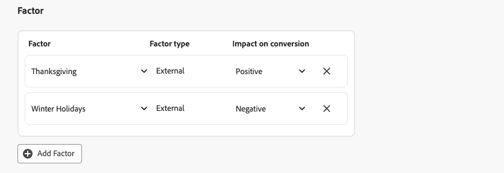
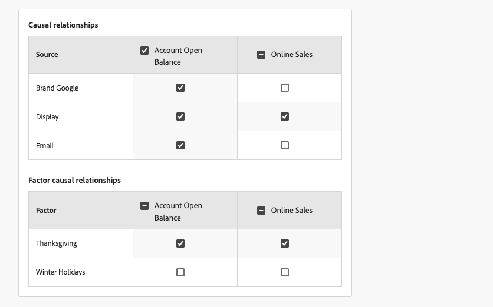
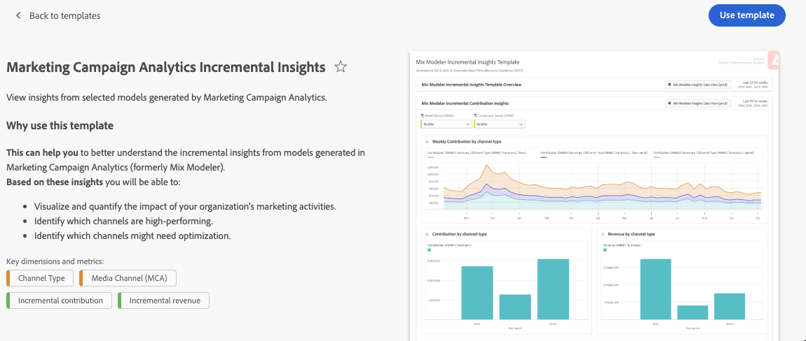

# Modelos de compilación

{{mm-mca-rebranding}}

Para crear sus modelos personalizados con tecnología de IA, la interfaz proporciona un flujo de configuración de modelo guiado paso a paso.

En la interfaz de  **[!UICONTROL Models]** en [!DNL Marketing Campaign Analytics], seleccione **[!UICONTROL Open model canvas]**.

## Configuración

Usted define un nombre y una descripción en el paso **[!UICONTROL Setup]**:

1. Escriba el modelo **[!UICONTROL Name]**, por ejemplo `Demo model`. Escriba un **[!UICONTROL Description]**, por ejemplo `Demo model to explore AI features of Marketing Campaign Analytics`.

   

1. Seleccione **[!UICONTROL Next]** para continuar con el paso siguiente. Seleccione **[!UICONTROL Cancel]** para cancelar la configuración del modelo.

## Configurar {#configure}

>[!CONTEXTUALHELP]
>id="model_marketingtouchpoints_select"
>title="Puntos de contacto de marketing"
>abstract="Los puntos de contacto de marketing son eventos de marketing a nivel de destinatario, individuales o de cookie que se utilizan para evaluar el impacto de las inversiones de marketing en las conversiones numéricas o basadas en ingresos.  No puede configurar el modelo con puntos de contacto que tengan datos superpuestos y debe haber al menos un punto de contacto con gasto."

El modelo se configura en el paso **[!UICONTROL Configure]**. La configuración implica la activación del modelado funnel completo, la definición de los objetivos de conversión, los puntos de contacto de marketing, la población de datos apta, los factores externos e internos, etc.

1. Si desea habilitar [modelado funnel completo](./overview.md#full-funnel-modeling), en la sección **[!UICONTROL Full funnel model]**:

   1. Seleccione **[!UICONTROL Enable full funnel modeling]**.
   1. Seleccione una conversión superior en el menú desplegable **[!UICONTROL Upper funnel conversion]**.

1. En la sección **[!UICONTROL Conversion goal]**:

   

   1. Seleccione una conversión en el menú desplegable **[!UICONTROL Conversion]**. Las conversiones disponibles son las que definió como parte de [Conversiones](../harmonize-data/conversions.md) en [!UICONTROL Harmonized datasets]. Por ejemplo, **[!UICONTROL Online Conversion]**.

   1. Puede seleccionar  **[!UICONTROL Create a conversion]** para crear una conversión directamente desde la configuración del modelo.

1. En la sección **[!UICONTROL Marketing touchpoints]**, puede seleccionar uno o más puntos de contacto de marketing, correspondientes a los puntos de contacto de marketing que definió como parte de [puntos de contacto de marketing](../harmonize-data/marketing-touchpoints.md) en [!UICONTROL Harmonized datasets].

   

   1. Seleccione uno o más puntos de contacto de marketing en el menú desplegable **[!UICONTROL Touchpoint include]**.

      * Puede usar  para quitar un punto de contacto.
      * Puede usar **[!UICONTROL Clear all]** para eliminar todos los puntos de contacto.

   1. Puede seleccionar  **[!UICONTROL Create a touchpoint]** para crear un punto de contacto de marketing directamente desde la configuración del modelo.

   >[!NOTE]
   >
   >No puede configurar el modelo con puntos de contacto que tengan datos superpuestos y debe haber al menos un punto de contacto con gasto.

1. De forma predeterminada, se genera una puntuación para todos los datos de la vista armonizada. Para puntuar solo un subconjunto de la población, defina uno o más filtros usando contenedores en la sección **[!UICONTROL Eligible data population]**.

   

   * Para cada contenedor, defina uno o más eventos.

     1. Para cada evento:

        1. Seleccione una métrica o dimensión de **[!UICONTROL _Seleccionar campo armonizado_]**.

        1. Seleccione el operador apropiado: **[!UICONTROL equals]**, **[!UICONTROL not equals]**, **[!UICONTROL less than]**, **[!UICONTROL greater than]**, **[!UICONTROL starts with]**, **[!UICONTROL doesn't start with]**, **[!UICONTROL ends with]**, **[!UICONTROL doesn't end with]**, **[!UICONTROL contains]**, **[!UICONTROL doesn't contain]**, **[!UICONTROL is in]** o **[!UICONTROL is not in]**.

        1. Escriba o seleccione un valor en **[!UICONTROL _Escriba o seleccione el valor_]**.

     1. Para agregar un evento adicional en el contenedor, seleccione  **[!UICONTROL Add event]**.

     1. Para quitar un evento del contenedor, seleccione .

     1. Para filtrar usando todos o cualquiera de los múltiples eventos definidos en el contenedor, seleccione **[!UICONTROL Any of]** o **[!UICONTROL All of]**. La etiqueta cambia de **[!UICONTROL Include ... Or ...]** a **[!UICONTROL Include ... And ...]**.

   * Para agregar un contenedor de población de datos apto, seleccione  **[!UICONTROL Add eligible population]**.

   * Para quitar un contenedor de población de datos apto, dentro del contenedor, seleccione  y **[!UICONTROL Remove container]** en el menú contextual.

   * Seleccione **And** y **Or** entre contenedores para generar definiciones más complejas para la población de datos elegible.

1. Puede administrar conjuntos de datos que contengan factores internos o externos en la sección **[!UICONTROL Factor]**.

   * Para agregar un conjunto de datos de factor, seleccione **[!UICONTROL Add Factor]**. Puede agregar un máximo de 30 factores a un modelo.

     

     1. Seleccione un(a) **[!UICONTROL Factor dataset]** del menú desplegable. Los factores disponibles son los factores para los que ha definido un campo armonizado en [reglas del conjunto de datos](/help/harmonize-data/dataset-rules.md#create-a-dataset-rule).

        En función del conjunto de datos seleccionado, **[!UICONTROL Factor type]** es **[!UICONTROL Internal]** o **[!UICONTROL External]**.

     1. Seleccione **[!UICONTROL Impact on conversion]** del menú desplegable. Las opciones disponibles son: **[!UICONTROL Auto]**, **[!UICONTROL Positive]** o **[!UICONTROL Negative]**. La opción predeterminada es **[!UICONTROL Auto]**, que permite al modelo determinar el impacto del conjunto de datos de factor.

   * Para eliminar un conjunto de datos de factor, seleccione .

   * Si el modelo está habilitado para [modelado funnel completo](./overview.md#full-funnel-modeling), debe definir relaciones causales y relaciones causales de factor para los factores que agregue al modelo.

     

     * Para definir relaciones causales, en la tabla **[!UICONTROL Causal relationship]** s, seleccione  para cada canal (**[!UICONTROL Source]**) para indicar si el canal influye en los KPI de conversión superior e inferior.

       Puede seleccionar  el encabezado de columna para el KPI de conversión superior y el KPI de conversión inferior para definir rápidamente que todos los canales influyen en el KPI.

     * Cuando haya definido factores, defina las relaciones causales de los factores. Para definir las relaciones causales del factor, en la tabla **[!UICONTROL Factor causal relationships]**, seleccione  para cada factor (**[!UICONTROL Factor]**) para indicar si el factor influye en los KPI de conversión superior e inferior.

       Puede seleccionar  el encabezado de columna para el KPI de conversión superior y el KPI de conversión inferior para definir rápidamente que todos los factores influyen en el KPI.

1. Para definir la ventana retrospectiva del modelo, escriba un valor entre `1` y `52` en **[!UICONTROL Give contribution credit to touchpoints occurring within]**... **[!UICONTROL weeks prior to the conversion]** en la sección **[!UICONTROL Define lookback window]**.

   Si el modelo está habilitado para [modelado funnel completo](./overview.md#full-funnel-modeling):

   * Para definir la ventana retrospectiva para funnel inferior, escriba un valor entre `1` y `52` en **[!UICONTROL Give contribution credit to touchpoints occurring within]**... **[!UICONTROL weeks prior to the conversion]** para **[!UICONTROL Lower funnel]** en la sección **[!UICONTROL Define lookback window]**.

   * Para definir la ventana retrospectiva para la funnel superior, escriba un valor entre `1` y `52` en **[!UICONTROL Give contribution credit to touchpoints occurring within]**... **[!UICONTROL weeks prior to the upper funnel conversion]** para **[!UICONTROL Upper funnel]** en la sección **[!UICONTROL Define lookback window]**.

1. Para definir la ventana de formación de un modelo, en **[!UICONTROL Define training window]**, seleccione dónde iniciar las conversiones de puntuación.

   

   Puede seleccionar entre:

   * **[!UICONTROL Have Marketing Campaign Analytics select a helpful training window]** y

   * **[!UICONTROL Manually input a training window]**. Cuando esté seleccionado, defina el número de años en **[!UICONTROL Include events the following years prior to a conversion]**.

   Esta entrada es necesaria para un modelo. La cantidad de años determina cómo se limita el canal y el stock, que puede configurar en el paso **[!UICONTROL Advanced]**.

1. Seleccione **[!UICONTROL Next]** para continuar con el paso siguiente. Si se necesita más configuración, un contorno rojo y texto explican qué configuración adicional se requiere.  Seleccione **[!UICONTROL Back]** para regresar al paso anterior.  Seleccione **[!UICONTROL Cancel]** para cancelar la configuración del modelo.

## Avanzadas {#advanced}

>[!CONTEXTUALHELP]
>id="model_advanced_channeladstock"
>title="Adstock del canal"
>abstract="Incorpore experiencia del dominio, resultados de la experimentación o análisis de canal anteriores directamente en la configuración del modelo. La configuración del Adstock ayuda a guiar el modelo para que se ajuste a las expectativas del mundo real y mejora la interpretabilidad y la confianza en el resultado. El total de semanas de retrospectiva más semanas de retardo por canal se limita a una octava parte de la ventana de formación configurada. Este límite permite que el modelo disponga de datos suficientes para conocer los efectos del Adstock."

Puede especificar la configuración avanzada en el paso **[!UICONTROL Advanced]**. En este paso, puede definir [gasto compartido](#spend-share), habilitar el modelo para [atribución multitáctil (MTA)](#mta), definir [conocimiento previo](#prior-knowledge) y definir [canal y stock](#channel-adstock).

### Gasto compartido

En la sección **[!UICONTROL Spend share]**:

* Para usar las relaciones de inversión de marketing históricas para informar al modelo cuando los datos de marketing son dispersos, active **[!UICONTROL Allow spend share]**.

  Si el modelo está habilitado para [modelado funnel completo](./overview.md#full-funnel-modeling):

  * Para usar las relaciones de inversión de marketing históricas para informar al modelo cuando los datos de marketing son dispersos, active **[!UICONTROL Allow spend share for the lower funnel]**.
  * Para usar las relaciones de inversión de marketing históricas para informar al modelo cuando los datos de marketing son dispersos, active **[!UICONTROL Allow spend share for the upper funnel]**.

* Se recomienda esta configuración, especialmente en los siguientes casos:
  * Un canal no tiene suficientes observaciones (por ejemplo, baja frecuencia de gasto, impresiones o clics).
  * Está modelando medios puntiagudos pero regulares y potencialmente de alto gasto (como TV para algunas marcas), donde los datos son escasos.

  >[!NOTE]
  >
  >Para inversiones puntuales (por ejemplo, un anuncio de la Super Bowl), incorpore esos datos como un factor en lugar de depender de la cuota de gasto.
  >

### MTA

En la sección **[!UICONTROL MTA enabled]**:

* Para habilitar las características de MTA para el modelo, active **[!UICONTROL MTA enabled]**. Si ha habilitado el MTA, las perspectivas de atribución multitáctil están disponibles después de haber entrenado y puntuado al modelo. Consulte la pestaña [Atribución](insights.md#attribution) en [Información del modelo](insights.md).

### Conocimientos previos

En la sección **[!UICONTROL Prior knowledge]**:

1. Seleccione **[!UICONTROL Rule type]**, que es de forma predeterminada **[!UICONTROL Absolute values]**.

1. Si el modelo está habilitado para [modelado funnel completo](./overview.md#full-funnel-modeling):

   * Seleccione **[!UICONTROL Lower funnel]** o **[!UICONTROL Upper funnel]** de **[!UICONTROL Select metric]** como métrica de funnel que se utilizará para el conocimiento previo.

1. Especifique los porcentajes de contribución para cualquiera de los canales enumerados en **[!UICONTROL Name]**, utilizando la columna **[!UICONTROL Contribution proportion]**.

1. Si corresponde, puede agregar para cada canal un porcentaje de **[!UICONTROL Level of confidence]**.

1. Si es necesario, use **[!UICONTROL Clear all]** para borrar todos los valores de entrada de las columnas **[!UICONTROL Contribution proportion]** y **[!UICONTROL Level of confidence]**.

### Adstock del canal

En la sección **[!UICONTROL Channel adstock]** puede definir retrospectivas de stock individuales (efectos de arrastre o deterioro) y un retardo (tiempo de respuesta demorado) para cada canal (canal de marketing) que haya definido en su modelo.

Esta configuración de stock de anuncios de canal permite un control detallado sobre cómo los distintos canales de marketing afectan a los resultados empresariales a lo largo del tiempo. También puede utilizar valores por defecto del sistema y una configuración estándar.

La configuración de canal de anuncios le ayuda a capturar matices específicos del canal. Por ejemplo, el impacto a largo plazo de las campañas de TV, el impacto a corto plazo de la búsqueda de pago o el desfase entre el gasto de los influenciadores y las conversiones observables. Experimente con los parámetros de retardo y retrospectiva de AdStock para generar perspectivas más precisas, personalizadas y fiables. En última instancia, la configuración de un canal y un stock puede dar lugar a asignaciones presupuestarias más precisas y mejores decisiones empresariales.

Para configurar un archivo de canal:

* Si el modelo está habilitado para [modelado funnel completo](./overview.md#full-funnel-modeling), seleccione **[!UICONTROL Lower funnel]** o **[!UICONTROL Upper funnel]** de **[!UICONTROL Select metric]** como métrica de funnel que se usará para el inventario de anuncios de canal.

* Para cada canal (**[!UICONTROL Name]**), defina un valor **[!UICONTROL Lag (weeks)]**, un valor **[!UICONTROL Min Lookback (weeks)]** y **[!UICONTROL Max Lookback (weeks)]**. Para cada valor:

  * Para aumentar un valor, use ; para reducirlo, use ; o escriba un valor manualmente.

  El total de semanas de retraso más las semanas de retrospectiva máximas por canal se limita a una octava parte de la ventana de formación configurada. Este límite permite que el modelo disponga de datos suficientes para conocer los efectos del Adstock. Por ejemplo, para una ventana de formación de dos años, el máximo de **[!UICONTROL Lag (weeks)]** y **[!UICONTROL Lookback (weeks)]** para un canal es de 13 semanas. Este límite se impone al definir los valores.

* Para restablecer todos los valores predeterminados de los anuncios de canal:

  * Seleccione **[!UICONTROL Reset to defaults]**.

## Definir opciones

Puede [programar entrenamiento y puntuación](#schedule), y especificar [campos granulares de informe de perspectivas](#granular-insights-reporting-fields) para su modelo en el paso **[!UICONTROL Set options]**.

### Programación

En la sección **[!UICONTROL Schedule]**, puede programar la formación y la puntuación del modelo.

Para programar la puntuación y la formación del modelo:

1. Activar **[!UICONTROL Enable scheduled model scoring and training]**.
1. Seleccionar un **[!UICONTROL Scoring frequency]**:

   * **[!UICONTROL Daily]**: escriba una hora válida (por ejemplo, `05:22 pm`) o use  para definir la hora.
   * **[!UICONTROL Weekly]**: seleccione un día de la semana e introduzca una hora válida (por ejemplo, `05:22 pm`) o use  para definir la hora.
   * **[!UICONTROL Monthly]**: seleccione un día del mes en el menú desplegable Ejecutar en cada e introduzca una hora válida (por ejemplo, `05:22 pm`) o use  para definir la hora.

1. Seleccione un(a) **[!UICONTROL Training frequency]** del menú desplegable: **[!UICONTROL Monthly]**, **[!UICONTROL Quarterly]**, **[!UICONTROL Yearly]** o **[!UICONTROL None]**.

### Customer Journey Analytics {#cja}

>[!CONTEXTUALHELP]
>id="model_enable_cja"
>title="Habilitar Customer Journey Analytics"
>abstract="Para que los datos de puntuación estén disponibles para informes y análisis en Customer Journey Analytics, habilite esta configuración. Una vez activado, debe eliminar el modelo para desactivar esta configuración."

{{release-limited-testing-section}}

Si tiene derecho a Customer Journey Analytics y ha creado una o más [reglas de conjuntos de datos](/help/harmonize-data/dataset-rules.md) para Marketing Campaign Analytics en una zona protegida concreta:

* Se crean dos conjuntos de datos de Marketing Campaign Analytics dedicados en su zona protegida de Experience Platform.
* Se crea una conexión [connection](https://experienceleague.adobe.com/es/docs/analytics-platform/using/cja-connections/overview) de Customer Journey Analytics con el título **[!UICONTROL Marketing Campaign Analytics Enabled Connection (_sandbox-name _)]**&#x200B;que contiene los conjuntos de datos de Marketing Campaign Analytics dedicados.
* Se crea una [vista de datos](https://experienceleague.adobe.com/es/docs/analytics-platform/using/cja-dataviews/data-views) de Customer Journey Analytics, con el título **[!UICONTROL Marketing Campaign Analytics Insights Data View (_sandbox-name _)]**, basada en la conexión.

Tanto la conexión como la vista de datos son propiedad del sistema. No puede actualizar ni eliminar la conexión o la vista de datos.

Para que los datos de puntuación del modelo estén disponibles para Customer Journey Analytics a través de los conjuntos de datos, la conexión y la vista de datos mencionados anteriormente:

* Seleccione **[!UICONTROL Enable scores for Customer Journey Analytics]**.

  Una vez habilitada esta opción, solo se puede deshabilitar eliminando el modelo.

Para informar y analizar los datos de Marketing Campaign Analytics rápidamente, en un [proyecto del espacio de trabajo](https://experienceleague.adobe.com/es/docs/analytics-platform/using/cja-workspace/home) de Customer Journey Analytics:

1. Seleccione **[!UICONTROL Workspace]** > **[!UICONTROL Adobe templates]**.
1. Seleccione la **[!UICONTROL Marketing Campaign Analytics Insights Data View (_sandbox-name _)]**&#x200B;dedicada como la vista de datos que se utilizará para un proyecto.
1. Seleccione **[!UICONTROL Marketing Campaign Analytics Incremental Insights]** [plantilla](https://experienceleague.adobe.com/en/docs/analytics-platform/using/cja-workspace/templates/use-templates#marketing-campaign-analytics-templates).
   * Seleccione **[!UICONTROL Preview]** para ver una vista previa.

     
   * Seleccione **[!UICONTROL Use template]** para crear un proyecto basado en la plantilla.

### Campos de informes de perspectivas granulares

La sección **[!UICONTROL Granular insights reporting fields]** utiliza la funcionalidad de informes de incrementalidad granular. Esta funcionalidad le permite seleccionar campos armonizados para desglosar las puntuaciones de incrementalidad de conversión y puntos de contacto.

Estos campos armonizados se definen de modo que se pueda explorar en profundidad el sistema de informes del modelo mediante columnas de informes granulares en lugar de tener que crear modelos separados.

Por ejemplo, crea un modelo centrado en los ingresos, pero también le interesa el rendimiento de la campaña, el tipo de medio, la región y las fuentes de tráfico. Sin la funcionalidad de creación de informes de incrementalidad granular, debe crear cuatro modelos independientes. Con la funcionalidad de creación de informes de incrementalidad granular, puede desglosar el modelo de ingresos en campañas, tipos de medios, regiones y fuentes de tráfico.

1. Seleccione uno o más campos armonizados de **[!UICONTROL _Seleccionar campos armonizados_]** debajo de **[!UICONTROL Includes]**. Los campos armonizados seleccionados se añaden al panel.
1. Seleccione **[!UICONTROL *Campo armonizado *]** para quitar un campo armonizado del contenedor con los campos armonizados seleccionados.
1. Seleccione **[!UICONTROL Clear all]** para eliminar todos los campos armonizados seleccionados.

Los campos armonizados seleccionados para los informes de incrementalidad granular están disponibles como parte de los conjuntos de datos [schema](/help/ingest-data/schemas.md) y [dataset](/help/ingest-data/datasets.md) de Experience Platform que resultan de la puntuación del modelo. Los campos de informes de datos detallados se pueden encontrar dentro de los objetos **[!UICONTROL conversionPassthrough]** y **[!UICONTROL touchpointPassthrough]**.

## Finalizar

* Seleccione **[!UICONTROL Finish]** para finalizar la configuración del modelo.

  * En el cuadro de diálogo **[!UICONTROL Create instance?]**, seleccione **[!UICONTROL Ok]** para almacenar en déclencheur el primer conjunto de entrenamientos y ejecuciones de puntuación inmediatamente. Su modelo aparece con el estado  **[!UICONTROL Awaiting training]**.

    Seleccione **[!UICONTROL Cancel]** para cancelar.

  * Si se necesita más configuración, un contorno rojo y texto explican qué configuración adicional se requiere.

* Seleccione **[!UICONTROL Back]** para volver al paso anterior.

* Seleccione **[!UICONTROL Cancel]** para cancelar la configuración del modelo.

